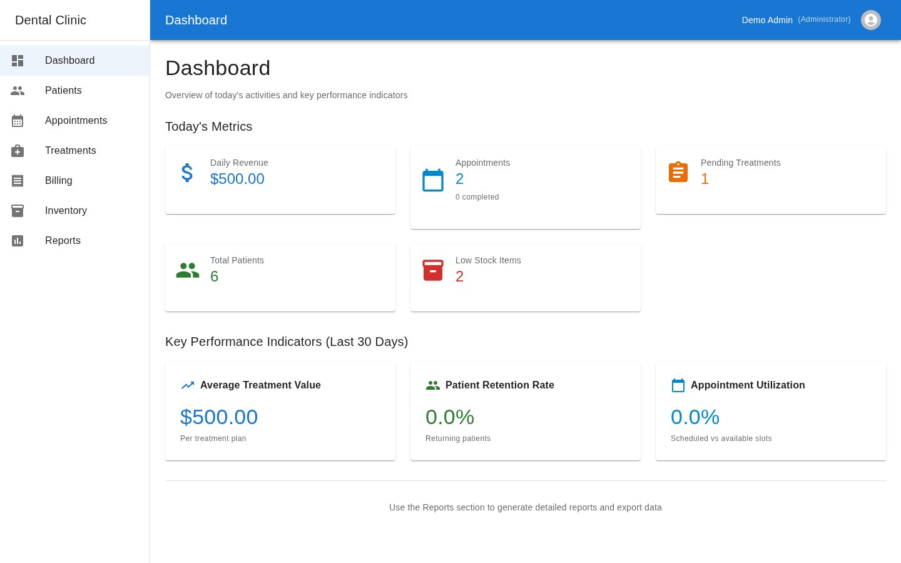
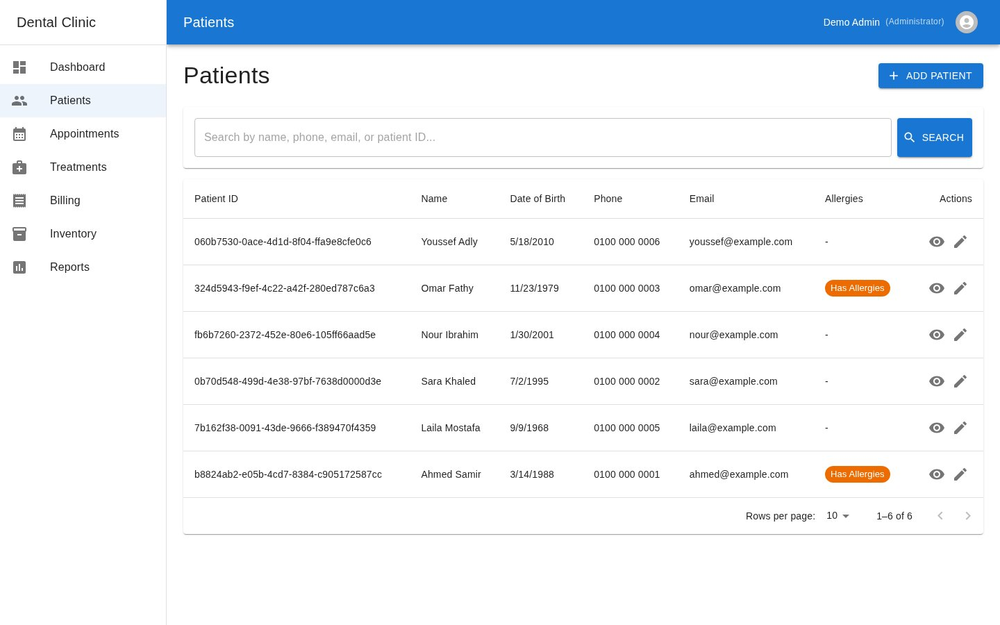
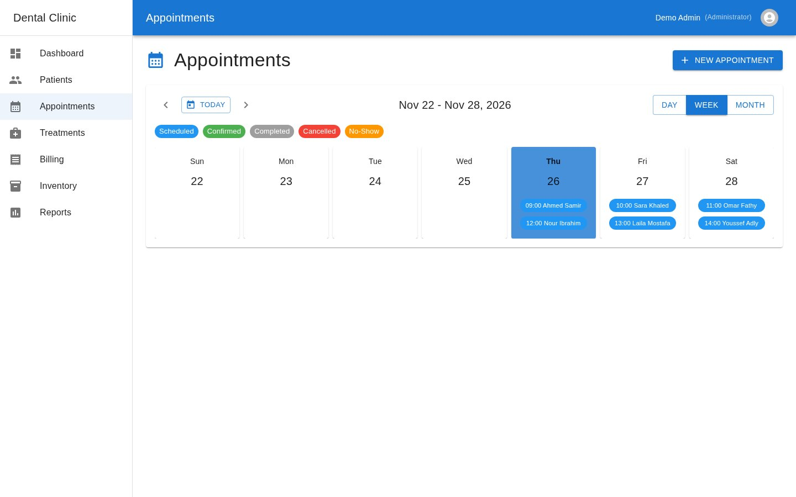
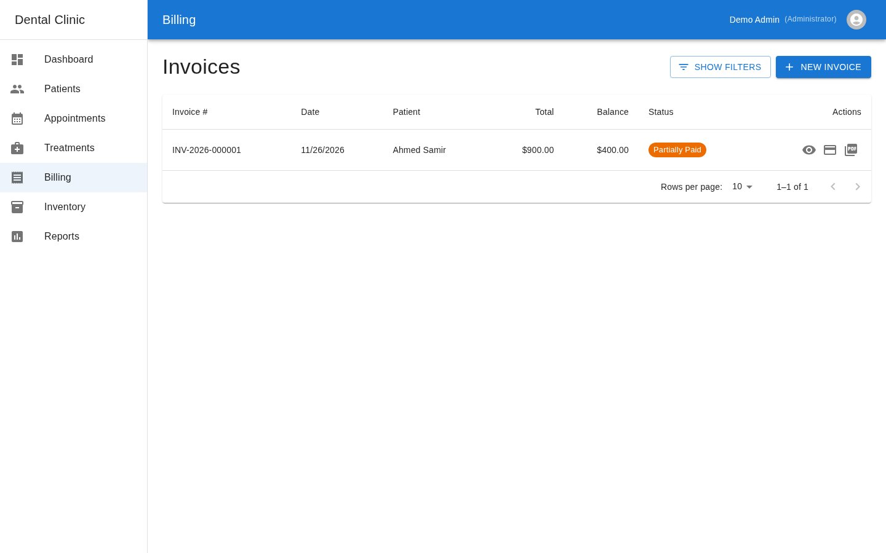
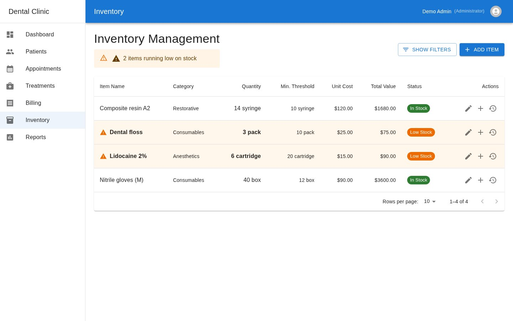
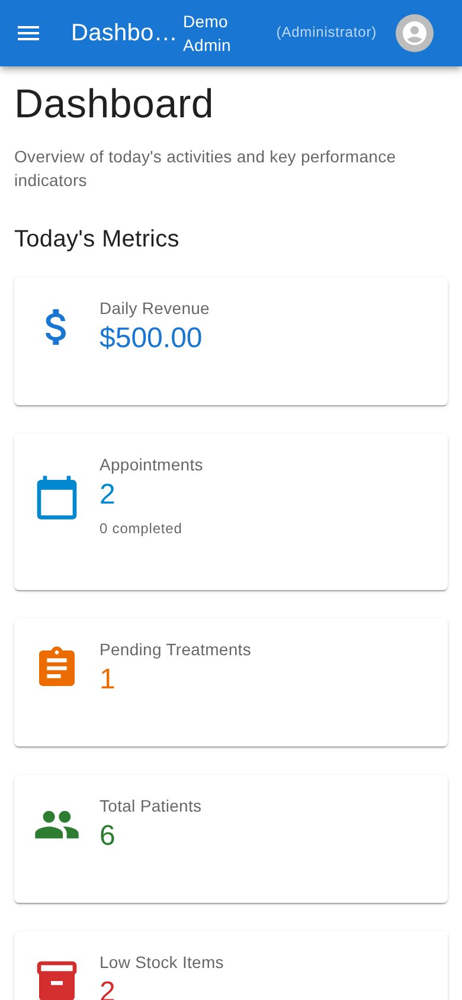
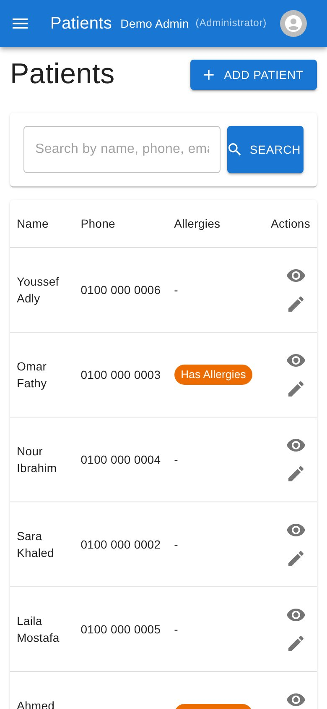

# Dental Clinic Management

An offline-first desktop app for running a dental clinic: patients, appointments, treatment planning with a tooth chart, billing, inventory and reports. The same code also builds as a browser demo.

**Live demo:** <https://dental-clinic-demo-ten.vercel.app/>

## Project Overview

The app is built with Electron, React and TypeScript. All data stays on the clinic's computer in a local SQLite database file (through sql.js), so it works without a network connection.

The `web-demo` branch adds a browser build of the same app. The main-process services run inside the page, and the database file is kept in your own browser's IndexedDB. That is what the live demo runs. Nothing you enter in the demo leaves your browser.

Status: working application with an automated test suite. It is a portfolio project and has not been used in a real clinic. Installers are not published, you build them yourself (see below).

## Features

- **Patients:** records with medical history, allergy warnings, clinical notes and document attachments (JPEG, PNG, PDF).
- **Appointments:** day, week and month calendar, conflict detection and status colors. In-app reminders for appointments about 24 hours ahead.
- **Treatment planning:** interactive 32-tooth chart (universal numbering), treatment templates, cost estimates and status tracking.
- **Billing:** invoices from completed treatments, payments (cash, credit card, debit card, check, insurance), discounts that need authorization depending on the amount, and PDF export.
- **Inventory:** stock levels, low-stock warnings, transaction history and stock adjustments.
- **Reports:** dashboard KPIs, daily appointments, revenue, patient visit history and inventory reports, with PDF and CSV export.
- **Accounts and roles:** Administrator, Dentist and Receptionist roles with permissions, bcrypt password hashing and a 30-minute session timeout.
- **Backups:** automatic daily backup at 02:00 in the desktop app, keeping the last 30 backups, and a database integrity check.

## Tech Stack

| Layer | Technology |
| --- | --- |
| Language | TypeScript |
| Desktop shell | Electron 28 |
| UI | React 18, Material UI, MUI date pickers |
| Database | SQLite through sql.js (WebAssembly) |
| PDF | pdfkit |
| Auth | bcrypt (bcryptjs in the browser build) |
| Build | Vite, electron-builder |
| Tests | Jest, Testing Library, fast-check (property-based tests) |

## Architecture

```
Electron app (desktop)                       Browser demo (web-demo branch)
-----------------------                      ------------------------------
Renderer: React UI  (src/renderer)           Same React UI
      | IPC                                        | calls the same handlers in the page
      v                                            v
Main process (src/main)                      src/web/bootstrap.ts
  ipc/ipcHandlers.ts                           shims: electron, fs, crypto
  services/ Auth, Patient, Appointment,        seeds made-up sample data
            Treatment, Billing, Inventory,
            ClinicalNotes, Report
      |                                            |
      v                                            v
DatabaseManager (sql.js) --> clinic.db       DatabaseManager (sql.js) --> IndexedDB
  in the app's user-data folder                (private to each visitor's browser)
```

```
src/
  main/        Electron main process: IPC handlers, services, auth middleware
  renderer/    React UI: components for each module
  database/    DatabaseManager: schema, migrations, backups
  shared/      Types used by both sides
  web/         Browser demo entry, shims and IndexedDB persistence (web-demo branch)
```

- The renderer never touches the database. It calls the main process through IPC, and the services hold the business rules (conflict checks, discount authorization, stock rules).
- Role permissions are checked in `authMiddleware`.
- sql.js runs SQLite in memory and writes the database file after changes. The browser demo reuses the same services and swaps in small browser versions of the Node modules.

## Screenshots

Taken from the live demo (made-up sample data).

| Dashboard | Patients |
| --- | --- |
|  |  |

| Appointments | Billing |
| --- | --- |
|  |  |

| Inventory |
| --- |
|  |

| Mobile dashboard | Mobile patients |
| --- | --- |
|  |  |

## Live Demo

<https://dental-clinic-demo-ten.vercel.app/>

Click "Try the demo as admin". The demo is a browser version with made-up data. Everything is stored in your own browser, so each visitor has a private copy, and clearing site data resets it. It runs on Vercel's free tier from the `web-demo` branch.

Differences from the desktop app: no automatic file backups, and data lives in IndexedDB instead of a file in the app's user-data folder.

## Installation & Setup

Requirements: a current Node.js LTS and npm. Electron is installed by `npm install`.

```bash
git clone https://github.com/osama-kamal/dental-clinic-management.git
cd dental-clinic-management
npm install
npm run dev        # renderer, main-process watcher and Electron together
```

Other commands:

```bash
npm test                 # Jest and property-based tests
npm run lint
npm run build            # build renderer and main process
npm run package:win      # also package:mac, package:linux (electron-builder, output in release/)
```

On first run the app creates a default Administrator account if no users exist (see `src/main/main.ts`). Sign in, then change that password right away.

### Run the browser demo locally

This build is on the `web-demo` branch.

```bash
git checkout web-demo
npm install
npm run build:web        # output in dist/web
```

The hosted demo uses `npm run build:web && cp dist/web/web.html dist/web/index.html` as the build command, with `dist/web` as the output directory and `npm ci --ignore-scripts` as the install command.

## Environment Variables

None are required. The app has no `.env` file and no API keys. The code only reads `NODE_ENV` (set by the build scripts). The database and backup folders come from Electron's user-data path.

## License

MIT, see `LICENSE.txt`.
